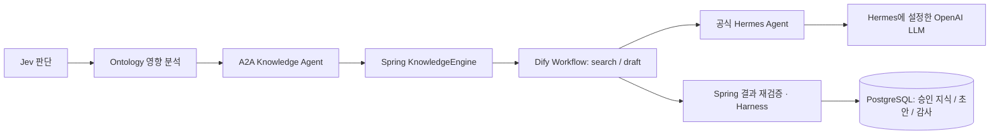

# S-CARE × Dify Cloud 연결 패키지

**추천 위치는 Knowledge Agent와 Hermes 사이입니다.** 장애 분석 때 승인 지식을 선택하고, 복구 검증 후 Skill 초안을 생성하는 두 작업을 Dify Workflow로 편집합니다. Jev·Ontology·A2A·Harness와 관리자 승인·PostgreSQL 저장은 기존 애플리케이션에 유지합니다.

이 폴더는 **가져오기용 DSL YAML, 가상 입력 예제, API 실행 도구, 오프라인 테스트**입니다. 현재 배포된 Spring Boot는 여전히 Hermes를 직접 호출합니다. Dify Cloud에서 실제 가져오기·게시·모델 호출을 검증하거나 Spring 자동 연결을 활성화한 상태는 아닙니다.

## 어느 지점에 붙이는가

| 처리 지점 | Dify의 역할 | 기존 기술의 역할 |
|---|---|---|
| 장애 접수·분류 | 이 워크플로의 범위 밖 | Jev가 유형·우선순위·부서를 판단 |
| 영향 분석 | 이 워크플로의 범위 밖 | Ontology/Neo4j가 영향 범위를 탐색 |
| A2A Knowledge Agent의 지식 검색 | `operation=search`: 프롬프트 구성 → Hermes 호출 → 승인 ID 검증 | Spring이 승인된 Skill·매뉴얼 후보와 가상 관측을 제공 |
| 대응 검토·승인·복구 | 승인 권한 없음 | Harness가 근거·권한을 검사, 담당자 승인 후 MCP가 가상 복구·검증 |
| 복구 검증 후 Skill 초안 | `operation=draft`: 적용 조건·점검·해결·주의사항 생성 | Spring이 DRAFT 저장 → 관리자 승인 → 기존 Hermes 게시 bridge |



Dify는 모델 자체가 아니라 작업 흐름을 편집·실행하는 계층입니다. 이 YAML은 Dify의 LLM 노드 대신 공식 Hermes HTTP API를 사용합니다. **OpenAI API 키는 기존 Hermes 서버에만 둡니다.** Dify 지식베이스로 원본을 복제하지 않고, 백엔드가 전달한 승인 후보 안에서 모델이 선택합니다. 네이티브 Dify RAG·벡터 검색은 포함하지 않습니다.

## 1. Dify Cloud에 가져오기

1. Dify Cloud의 Studio에서 **Import DSL File / DSL 파일 가져오기**를 선택합니다.
2. 이 폴더의 **[s-care-hermes-knowledge.yml](s-care-hermes-knowledge.yml)**을 업로드합니다. 별도 모델 플러그인 설치는 필요하지 않습니다.
3. 워크플로에 입력, 검증, REAL/DEMO 분기, Hermes HTTP 호출, 결과 반환 노드가 보이는지 확인합니다.
4. 먼저 Preview/Test Run에서 아래 값으로 실행합니다.

| 입력 | 검색 테스트 | 초안 테스트 |
|---|---|---|
| `mode` | `DEMO` | `DEMO` |
| `operation` | `search` | `draft` |
| `context_json` | [search-context.json](examples/search-context.json)의 **내용 전체** | [draft-context.json](examples/draft-context.json)의 **내용 전체** |

파일 경로나 JSON을 다시 감싼 따옴표를 넣지 않습니다. `{`로 시작하는 JSON 객체 텍스트를 붙여넣습니다. 예제의 ID는 독립 검증용 가상 값이며 실제 S-CARE DB에 존재한다고 가정하지 않습니다.

DEMO 결과의 `result_json`을 확인합니다. `provider=MOCK_DIFY_HERMES`, `simulated=true`, `hermesConnected=false`가 나와야 합니다. 초안은 적용 조건·점검 절차·해결 방법·주의사항 4개 필드를 반환합니다. **실제 모델 판단이 아닙니다.**

이 YAML의 DEMO 분기는 Hermes·LLM을 호출하지 않습니다. Dify Cloud 실행 자체에는 인터넷과 Dify가 필요합니다. **기존 S-CARE DEMO는 향후 연결 후에도 Dify를 호출하지 않고 로컬 Mock으로 실행**해야 독립 시연이 유지됩니다.

## 2. REAL용 값 3개 설정

워크플로의 Environment Variables에서 설정합니다. 가져온 파일의 키는 비어 있습니다.

| 변수 | 입력할 값 | 주의할 구분 |
|---|---|---|
| `HERMES_BASE_URL` | `https://전용-Hermes-도메인/v1` | Dify Cloud에서 접근 가능한 HTTPS 주소. S-CARE 프론트엔드·backend 주소가 아님 |
| `HERMES_API_KEY` | Hermes API 서버 인증 키 | **Secret 타입** 유지. OpenAI 키·S-CARE ADMIN_TOKEN·Skill 게시 키와 다름 |
| `HERMES_MODEL` | 기본 `hermes-agent` | Hermes 서버의 모델 별칭. 내부 OpenAI 모델은 Hermes 서버 설정을 따름 |

현재 배포 문서의 Hermes는 Railway **내부 네트워크**를 사용합니다. `127.0.0.1:8642`, `*.railway.internal`은 Dify Cloud에서 접속할 수 없습니다. REAL 연결에는 전용 HTTPS 진입점이 추가로 필요합니다. 예를 들어 같은 프로젝트의 인증 프록시가 공식 Hermes의 `GET /v1/toolsets`, `POST /v1/chat/completions`만 전달하도록 구성할 수 있습니다. Skill 쓰기 bridge 8643은 이 워크플로에 필요하지 않습니다. **이 패키지는 공개 도메인·프록시를 생성하거나 현재 서버 공개 범위를 변경하지 않습니다.**

전용 Hermes 설정에서 `platform_toolsets.api_server: []`, `platform_toolsets.cli: []`, `mcp_servers: {}`를 유지합니다. YAML은 모델 호출 전에 `/v1/toolsets`의 모든 항목이 명시적으로 `enabled=false`인지 확인하며 그렇지 않으면 중단합니다. 설정 변경을 막는 서버 운영 통제도 필요하며, 사전 조회만으로 실행 시점의 권한 통제를 대체하지 않습니다.

주소·키 설정 후 같은 가상 입력에서 `mode=REAL`로 실행합니다. OpenAI 호출은 Hermes의 기존 계정/모델 설정을 이용합니다. 성공한 결과는 `provider=HERMES_AGENT`, `orchestrator=DIFY_WORKFLOW`, `simulated=false`로 표시합니다. `model`은 Hermes 응답의 값이며 응답에 없으면 `unreported`입니다. `hermes-agent`가 반환되면 실제 내부 OpenAI 모델명을 확인했다는 뜻이 아닙니다.

## 3. 게시 후 API로 실행

Dify에서 Publish한 뒤 해당 **Workflow 앱의 API 키**를 발급합니다. Dify 문서의 `POST /v1/workflows/run`을 호출합니다. 키는 프론트엔드 환경변수나 YAML에 넣지 않습니다.

저장소 루트에서 아래 명령을 실행합니다. Python 3.12 이상 권장. API 실행 도구는 표준 라이브러리만 사용하며 `.env`를 자동으로 읽지 않습니다.

```powershell
# 요청 형식만 확인: API 키도 네트워크 호출도 필요 없음
python integrations/dify/run_workflow.py --context integrations/dify/examples/search-context.json --dry-run

# PowerShell 7: 입력 내용을 표시하지 않고 현재 프로세스에만 키 설정
$env:DIFY_APP_API_KEY = Read-Host 'Dify Workflow App API key' -MaskInput

# 게시한 Dify Cloud 워크플로의 DEMO 검색
python integrations/dify/run_workflow.py --context integrations/dify/examples/search-context.json --mode DEMO --operation search

# Hermes 주소/키 설정 후 REAL 초안 생성
python integrations/dify/run_workflow.py --context integrations/dify/examples/draft-context.json --mode REAL --operation draft

Remove-Item Env:DIFY_APP_API_KEY
```

독립 ZIP을 풀었다면 `integrations/dify/` 폴더가 포함된 압축 해제 루트에서 같은 명령을 사용합니다. 성공하면 `workflow_run_id`와 검증된 출처 메타데이터·내용을 출력합니다. **이 도구는 장애나 Skill을 DB에 저장하지 않습니다.**

HTTP 요청 형태:

```json
{
  "inputs": {
    "mode": "DEMO",
    "operation": "search",
    "context_json": "가상 context 객체를 JSON 문자열로 직렬화한 값"
  },
  "response_mode": "blocking",
  "user": "s-care-fictional-dify-demo"
}
```

Cloud의 blocking 요청은 100초 제한이 있습니다. 이 예제는 Hermes 생성 read timeout 60초, 클라이언트 timeout 95초를 사용하지만 전체 완료를 보장하지 않습니다. 오래 걸리는 모델이나 세부 진행 이벤트가 필요하면 후속 Spring 어댑터를 streaming/SSE 방식으로 구현합니다. 연결 중단·시간 초과는 모델 실행 취소를 뜻하지 않으므로 자동 POST 재시도는 하지 않습니다. Dify 실행 로그를 먼저 확인합니다.

## 4. 결과와 실패의 의미

- `content`: search는 `skillIds`, `manualIds`, `explanation`; draft는 `conditions`, `checks`, `solution`, `cautions`.
- `latencyMs`: 입력 검증 이후 Dify 노드 처리 시간을 측정합니다. `latencyScope=DIFY_WORKFLOW`이며 브라우저·Spring 왕복 전체 시간은 아닙니다.
- `requiresBackendValidation=true`: 반환 값이 관리자 승인이나 저장 완료를 뜻하지 않습니다.
- 입력은 가상 데이터, 분류 확인, 승인 후보만 허용합니다. 입력 65,536자, 후보 Skill 40개·매뉴얼 60개·유사 장애 3개 한도를 초과하면 오류가 납니다. 후속 어댑터가 DB에서 관련 후보를 제한해야 합니다.
- 초안 요청은 가상 복구 통과와 승인 근거를 요구합니다. 입력의 `approved=true`는 보안상 승인 권한이 아니므로 Spring이 실제 DB 상태와 대조해야 합니다.
- REAL의 HTTP 오류·활성 도구·잘못된 JSON·미승인 ID는 워크플로 실패로 남습니다. YAML 내부에서 Mock 성공으로 바꾸지 않습니다. 향후 Spring 연결에서 기존 명시적 Mock 대체 정책을 적용하고 실패 원인·요청 경로·실제 Provider를 감사 기록해야 합니다.
- 모델의 근거 정확성·실제 해결 효과는 스키마 검증만으로 증명되지 않습니다. Harness와 담당자 검토가 계속 필요합니다.

## 5. Spring 자동 연결 시 구현할 계약

**아래는 다음 구현 작업이며 현재 설정만으로 활성화되지 않습니다.** 기존 코드 접점은 [KnowledgeEngine.java](https://github.com/namonamho88-ui/s-care/blob/main/backend/src/main/java/demo/brain/KnowledgeEngine.java)의 `generate/search/draft`와 [HermesAdapter.java](https://github.com/namonamho88-ui/s-care/blob/main/backend/src/main/java/demo/brain/HermesAdapter.java)입니다.

1. `DifyHermesAdapter implements HermesAdapter`를 추가하고 REAL 지식 경로에만 선택 옵션을 둡니다. 기본값은 현재 직접 Hermes 호출을 유지합니다. DEMO는 기존 `MockHermesAdapter`를 직접 호출합니다.
2. 서버에서만 Dify App API 키를 읽습니다. 승인 후보·가상 관측·복구 검증의 허용 필드만 DTO로 구성합니다. ADMIN_TOKEN, DB 접속 정보, OpenAI 키, 사용자 세션은 보내지 않습니다.
3. Workflow Run API에 `context_json` 문자열을 전달합니다. `data.status=succeeded` 확인 후 `data.outputs.result_json`을 다시 JSON으로 파싱하고 모드별 출처를 검사합니다. CLI 예제를 전송 계약의 참고로 사용합니다.
4. 모델이 선택한 ID를 **그 시점의 승인 DB 레코드와 재검증**합니다. 초안 저장 직전 가상 복구 통과·승인·장애 상태와 중복 요청을 검사합니다. 외부 호출을 DB 트랜잭션 밖에 둡니다.
5. 기존 Skill DRAFT 저장, 관리자 승인, 전용 Hermes 게시 bridge를 사용합니다. YAML이 `/approve`, 복구 MCP, DB 쓰기를 직접 호출하지 않게 합니다.
6. `workflow_run_id`, 요청 경로 `DIFY_WORKFLOW`, 실제 provider/model, simulated, fallback 원인, 소요 시간을 저장하고 기술 안내·감사·실행 근거 UI에 반영합니다. Dify 실패 시 Mock 대체를 실제 Hermes 성공으로 표시하지 않습니다.
7. 계약 테스트 외에 실제 Cloud → 전용 HTTPS → Hermes 테스트와 Spring → Dify → DB/승인 경계 통합 테스트를 수행한 뒤 활성화합니다. 현재 YAML 검증을 이 전체 연결 검증으로 대신하지 않습니다.

## 개발·검증

`nodes/*.py`가 코드 노드의 원본이며 생성된 YAML에는 소스가 모두 포함되어 있습니다. Dify로 가져갈 파일은 YAML 한 개입니다.

```powershell
python -m pip install -r integrations/dify/requirements-dev.txt
python integrations/dify/generate_dsl.py
python integrations/dify/generate_dsl.py --check
python -m unittest discover -s integrations/dify -p test_workflow.py -v
```

2026-10-12 기준 오프라인 **26개 테스트**가 통과했습니다. YAML의 실제 내장 코드를 로드해 분기·입출력 계약을 실행하고 HTTP 경계만 가상 응답으로 대체했습니다. DEMO 무모델 호출, REAL 검색·초안, JSON escaping, 출처, 승인 ID, 승인 없는 복구, 활성 도구, HTTP 실패, API 클라이언트·한글 UTF-8 출력을 검사합니다. **Dify 자체 엔진/샌드박스에서의 실행이나 Cloud 가져오기 성공을 검증한 것은 아닙니다.**

공식 Dify **1.17.1 / DSL 0.7.0 / graphon 0.7.0**의 소스·노드 스키마를 기준으로 작성했습니다. Cloud 배포 버전은 달라질 수 있으므로 가져오기 화면의 호환성 결과를 확인합니다. 비밀 값은 내보낸 YAML에 포함하지 않습니다.

공식 참고 자료:

- [DSL 가져오기와 앱 관리](https://docs.dify.ai/en/cloud/use-dify/workspace/app-management)
- [HTTP Request 노드](https://docs.dify.ai/en/cloud/use-dify/nodes/http-request), [Code 노드](https://docs.dify.ai/en/cloud/use-dify/nodes/code)
- [Workflow Run API·게시·시간 제한](https://docs.dify.ai/en/api-reference/workflow-runs/run-workflow)
- [Dify 1.17.1 DSL 버전 소스](https://github.com/langgenius/dify/blob/1.17.1/api/constants/dsl_version.py)
- [프로젝트 Hermes/배포 구성](https://github.com/namonamho88-ui/s-care/blob/main/docs/DEPLOYMENT.md)
